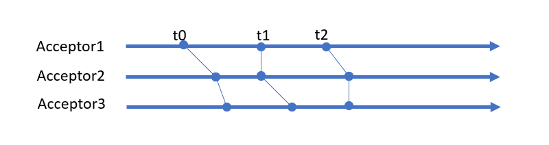
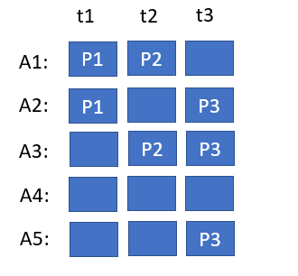
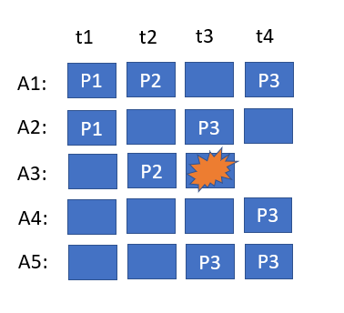
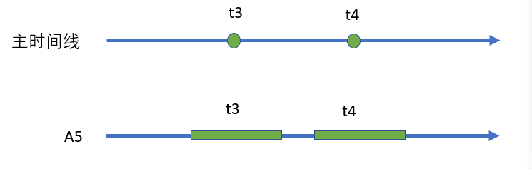
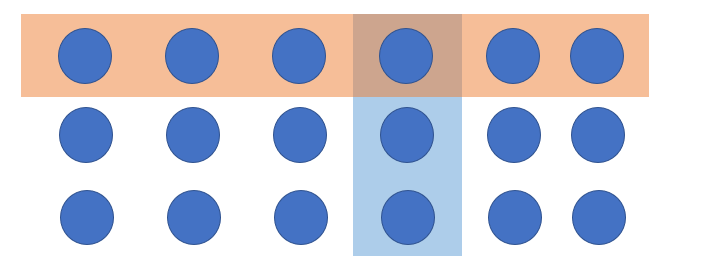

<aside class="source-note">

**Repost Note**

- Original author: canonical
- Original article: [Zhihu — *Paxos的魔法学研究报告*](https://zhuanlan.zhihu.com/p/193117183)
- Completeness basis: [Author's Markdown source in repository](https://github.com/entropy-cloud/nop-entropy/blob/c8739a5c544b1e0ea1d4ee3d644ce71c62b6a030/docs/theory/paxos.md)

This edition is translated from the author's public Markdown source, preserving all five original figures and the NopPlatform links at the end. Aside from this note and the review summary below, no original content was added or removed.

</aside>

## GPT-5.6-sol Review Summary

The following review summary is from OpenAI GPT-5.6-sol.

This is a distinctive technical essay well suited for building intuition after you already know the basic steps of Paxos. Its greatest strength is connecting ballot numbers, fencing, quorum intersection, and the distinction between a value being chosen and a node knowing the outcome through vivid metaphors such as "time stop," "zombie leader," and "symmetry breaking." Sections 5 and 6 are especially worth reading.

However, it should not be used on its own as an implementation specification for Paxos. Proposal IDs are chosen by Proposers, and Phase 1 typically requires only a majority response; "time stop" accurately means only that an Acceptor has not seen a higher ballot, not that concurrency has actually halted; and a log entry written locally by a Leader before commit is not yet immutable. Keeping these boundaries in mind and reading this alongside [Paxos Made Simple](https://www.microsoft.com/en-us/research/publication/paxos-made-simple/) makes the essay far more helpful.

---

The Paxos algorithm is not long—written on paper, it takes only four short sentences. The main reason it reads like cryptic scripture is that we often do not see the design intent behind those simple rules: why do they work, and why can we not do without them? Distributed systems are inherently chaotic, full of conflict and random failures, yet Paxos establishes a unified, consistent world of consensus atop that chaos. It looks like a miracle. Mortals struggle to understand miracles from their limited everyday experience. This essay attempts to interpret Paxos from the perspective of arcane magic, building a concise mental picture that makes the algorithm intuitive.

## 1. A God's Troubles

First, let us consider the problem a god faces and why it is frustrating.

Suppose a god needs a group of followers to collectively accomplish the same task. The first problem is that nobody is reliable. You assign a task to A, and A might miss it while daydreaming, respond sluggishly, or simply lie down halfway through and refuse to work. This problem is relatively easy to handle: it does not matter if one person is unreliable as long as enough people in the group are reliable. Each time, the god can simply guide a core subset to get the work done, and let the rest learn the oracle from them.

The truly thorny problem is that many things happen **in parallel**. Just after the god assigns work to A and turns to instruct B, A's situation changes (for instance, A receives an oracle from another god). The god has to hurry back to A with a new oracle; no sooner is A sorted out than B runs into a new complication, and the god must rush back again. After a few rounds of this, even an omniscient, omnipotent deity with the best of tempers would lose patience.

## 2. Ninth-Circle Magic: Time Stop

As a supreme being above finite objects, a god does not actually suffer this frustration. With a single word—"Freeze"—the god casts the ninth-circle spell **Time Stop**, silencing the noisy world and proceeding calmly with whatever must be done.

In modern physics, time is merely a measure of change. We define time by comparing the periodic motion of a pendulum with other motions. If no change is observed, perceived time has not advanced. In particular, if every atom in the universe slowed its oscillation in unison, humans inside it could never tell.

Recall the steps of Paxos. A Proposer first establishes a unique `ProposalID` through the `promise` phase; whenever any event that matters occurs (such as receiving a new message), the `ProposalID` increases. Thus `ProposalID` acts as a marker of time. When an Acceptor receives an `accept` message and sees that the `ProposalID` has not changed since the earlier `promise`, it knows that time has stood still in the interim—**no event of concern has occurred**.



Every Acceptor records a monotonically increasing `ProposalID`, establishing its own local arrow of time. Aligning the whole system on a `ProposalID` bundles multiple local arrows of time into a single coarse-grained global arrow of time (provided that events occurring at the same point in time are identical, such as setting the same value). The passage of time sweeps across the system like a wavefront.

From a god's viewpoint, then, Paxos is merely the trick of using Time Stop to **force multiple timelines into alignment along one master timeline**.

This "stop-and-align" technique is a fundamental strategy for consensus in distributed systems. In Kafka, for example, consumers in a consumer group act independently yet must agree on partition assignment. When membership or topic structure changes, a rebalance is triggered: the Coordinator first asks all workers to stop their current work, advance together to the next epoch, and only then distributes the new assignment, which is valid solely within that epoch.

Optimistic locking in databases follows the exact same strategy. At the start of a handler, you read the version number of `MainRecord`, modify `MainRecord` and related `SubRecord`s, and commit in one transaction while attempting to increment the version:

```
  update MainRecord
  set version = version + 1
  where version = :record_version
```

If the update succeeds, time stood still throughout the operation—no one else performed a conflicting action.

## 3. Eighth-Circle Magic: Grand Puppetry

Casting ninth-circle magic consumes enormous mana. A frugal god would never waste mana needlessly. Once time has been stopped, the best way to keep distant nodes acting in unison is to cast the eighth-circle spell **Grand Puppetry**, replicating one node's actions onto every other node.

Once the Leader initiates a new action, it crosses physical distance to take effect on remote Followers, who have no right to object—only the duty to execute. In our low-magic world, however, implementing Grand Puppetry is not effortless; we usually add a log file on both the sender and the receiver.

The sender writes each decision into its log, turning it into an immutable oracle. A delivery component scans the log and forwards entries one by one. If the receiver is unreachable, a send fails, or no expected response arrives, the sender cannot give up—it must **retry persistently** until acknowledged, guaranteeing **At Least Once** delivery. The receiver must accept all messages without tampering, and because duplicates may arrive, it uses its local log for **idempotency checks** to filter duplicates, achieving **At Most Once** processing. When messages pass through a streaming pipeline, intermediate nodes use **snapshots** to record completed state so they do not have to replay from the beginning.

Both Multi-Paxos and Raft are concrete implementations of this replication strategy. Once a leader is elected, a single Term number can be reused to issue many commands distinguished by their log index.

Notice that network messages fall into two categories: **Requests**, where the receiver may exercise discretion and either succeed or raise an error, and one-way **Notices**, where the handling is fixed and the receiver cannot refuse.

Two-Phase Commit (2PC) is an interesting illustration. In the Prepare phase, Participants receive a Request and may independently choose to commit or abort. Once a Participant sends its vote to the Coordinator, it surrenders autonomy and promises to follow the Coordinator's Notice thereafter. If the Coordinator decides to commit, the Participant will never abort; if the Participant aborts, the Coordinator can only abort. Their choices are no longer independent—they are entangled.

Viewed individually, each Participant and the Coordinator could be in either Commit or Abort. Viewed as a whole, however, only `|Commit, Commit>` and `|Abort, Abort>` are valid states in the state space: during 2PC, the system occupies a **quantum-entangled state** of `|Commit, Commit>` and `|Abort, Abort>`.

## 4. The Secret of Magic: What Is Unseen Does Not Exist

As mortals, we have no mana, yet we have all seen stage magic and experienced "witnessing a miracle." The illusion works because the magician directs our attention only to revealed facts while hiding what happens under the hood. Arcane magic works on the same principle: simply ensure that any fact incompatible with the spell is erased from perception.

While Paxos tries to hold time still, disruptive messages keep arriving. An Acceptor may receive a message from the past (`ProposalID` smaller than the current one); Paxos's solution is to **pretend it never saw it and drop it**. An Acceptor may also receive a message from the future. Simply dropping it would behave like a distributed lock with poor fault tolerance: the current Proposer might have crashed before completing its write. Faced with the present versus the future, the Acceptor abandons the current round and embraces the future. (Of course, if the Acceptor already knows via a Learner that a value has been chosen, it can reject future requests directly.) Similarly, in Raft, to prevent election churn, `RequestVote` messages from the future are ignored as long as heartbeats confirm an active Leader.

In leader-election algorithms, a classic problem is **preventing split-brain**. What if a new Leader has been elected while the old Leader refuses to step down and keeps interfering? The general solution is to **declare the old Leader a zombie and completely ignore every message from the previous epoch** (rejecting all requests with a smaller epoch). We do not stop the old Leader from acting inside its own private bubble; we simply ensure its actions can never affect the main world. Upon taking office, the new Leader performs a **write-before-read**, stamping its own epoch onto the main world so that any stale Leader attempting to commit fails its optimistic check and gives up.

In physics, observation and measurement carry profound theoretical weight: in quantum field theory, wild virtual processes compete and annihilate in unseen imaginary time, leaving only their net effect in observable reality. Likewise, controlling what is observable shapes the effective truth of a distributed system.

## 5. Mortal Consensus: Symmetry Breaking

In mathematical terms, all participants start equal—they are **symmetric**. Everyone may hold an opinion, and every opinion deserves equal respect; so why does one opinion prevail to become consensus? Fundamentally, reaching consensus is **symmetry breaking**.

The most basic symmetry-breaking mechanism is majority voting. Because no set can contain two disjoint majorities, once a majority of Acceptors accept a value at a given `ProposalID`, that value becomes the **chosen value** and consensus is reached.

### When Is Consensus Reached?

At the exact instant consensus is reached, who among the participants knows it? Remarkably, **nobody**—neither Acceptors nor Proposers! Only as the algorithm continues to run is the fact that consensus has been reached gradually revealed.



Consider five Acceptors and multiple Proposers. At `ProposalID = t1`, proposal `P1` is accepted by `A1` and `A2`—not a majority, so no value is chosen. At `t2`, `P2` also fails to reach a majority. At `t3`, `P3` is accepted by the majority `{A2, A3, A4}`, achieving consensus.

Before consensus is reached, **an Acceptor may change the value it has accepted**—for example, `A3` accepts `P2` and later accepts `P3`, because a Proposer may vanish at any time. Thus when `A3` accepts `P3`, it cannot know that consensus has been reached. `A2` and `A4` likewise see only their local state. On the Proposer side, until it receives majority acknowledgments, it does not know whether `P3` was chosen either. **Consensus belongs to the system as a whole; individual participants learn of it only over time.**

### Can Reached Consensus Be Overturned?

In the example above, after consensus `P3` is reached at `t3`, could we reach a different consensus `P4` at `t4`? For an omniscient god, choosing different values at different times would be no problem. For mortals with finite perception, allowing consensus to flip would cause cognitive chaos: how would you know which value to use without scanning every timestamp from `t1` to `tn`?



Now suppose `A3` crashes while processing `P3`. From the outside, two cases are indistinguishable:

1. `A3` accepted `P3` before crashing, so consensus was reached.
2. `A3` did not accept `P3`, so consensus was not reached.

Nobody except `A3` knows, and `A3` is dead. If different timestamps could hold different consensuses, history would remain trapped in quantum indeterminacy.

What mortals want is **monotonicity**: the system moves in one direction and, once it reaches a decided state, stays there forever. Whenever we want to read the result, we simply advance the system one step: if consensus was already reached, advancing returns that same value; if not, advancing chooses a value and eliminates uncertainty. In the example above, running one more round of Paxos yields `P3` at `t4` regardless of what `A3` did at `t3`, resolving all ambiguity—much like observing a quantum system collapses it into an eigenstate, while observing an already-collapsed eigenstate leaves it unchanged.

### How Do We Ensure Consensus Never Changes?

Consensus lives on the master timeline. Two distinct points on a timeline are independent unless we introduce a mechanism to carry information from one point to the next.

Because events on the master timeline are ordered by time, the simplest way to keep consensus unchanged is **read-before-write**: peek at what happened before writing.



If a write at `t4` peeks at `t3` and **reuses `t3`'s value**, consistency is preserved.

Under Time Stop, a single point on the master timeline corresponds to an atomic read-process-write interval in the lower world without overlapping other intervals. In the figure above, `t4` on `A5` lies strictly after `t3` and cannot interleave with it, so `t4` is guaranteed to see `t3`'s result.

In Phase 1, Paxos collects values already accepted by a majority of Acceptors:

1. **If consensus has already been reached**, Phase 1 is guaranteed to return that chosen value, and it **must be the one with the highest `ProposalID`**. Proof: if consensus was reached at `t3`, then `t4` immediately following it saw `t3`'s result and by rule adopted the chosen value. Hence if the value with the highest `ProposalID` is not the chosen value, consensus could not have been reached earlier.
2. **If consensus has not yet been reached**, the Proposer is free to pick any value—so generously adopting the value with the highest `ProposalID` is completely valid.

Some wonder: if a Proposer submits someone else's value, what about its own? Remember that Paxos's goal is **reaching consensus**, not forcing one's own value to win. Helping another proposal simply accelerates convergence; if a Proposer sees responses from all Acceptors confirming no consensus exists yet, it is free to insist on its own value.

## 6. Certainty Atop Uncertainty

To mortals, the world is filled with unsettling uncertainty; every action has three possible outcomes: **1. Success, 2. Failure, 3. Unknown**. Isolated single-machine systems once gave us a binary utopia of success or failure, but distributed reality exposes this fundamental uncertainty.

To survive in an uncertain world, we cooperate to form a collective consciousness that outlives any individual. Is a **Majority** the only way to form such a collective? No—continuity only requires intersection.

Consider a **Grid Quorum**:



In a `3 × 6` grid of Acceptors, suppose we define a write quorum as **any single column**. Two columns are disjoint, so to prevent conflicting choices we build a horizontal bridge: require Phase 1 reads to read **at least one full row**. Because every row intersects every column, any subsequent row read is guaranteed to see the previously chosen column write. Neither the row quorum nor the column quorum—nor even their union (`3 + 6 - 1 = 8` nodes out of 18)—is a majority. Read and write quorums do not need to be identical or form majorities; they only need to intersect so information can flow between them.

Transcending the individual simply means elevating each node into a member of quorums. As long as past and future quorums intersect and coordinate without contradiction, a unified collective will emerges.

## 7. The Secret of Time

To mortals, time feels like a mystical a priori backdrop. All our coordination seems to rely on the direction given by the arrow of time. Newton first noted that time separates cause from effect:

> `F = m * a`, Cause = linear coefficient * Effect

Later, Einstein imagined sending a photon to probe the surrounding world and uncovered a stunning secret: **there is no single timeline**.

When timelines are not unique, how do we avoid losing our way? One option is to **remember all timelines**, yielding **Vector Clocks**. Another is to **align all timelines into one**, yielding **Paxos**.

Is there a third option? Imagine breaking free from causality altogether, where "before" and "after" no longer matter. Cause precedes effect only because operations do not commute. In a high-magic world where operations commute, one can cast the **tenth-circle spell: Causality Inversion**—have you met **CRDTs**?

## 8. Epilogue

The boundary between mortals and gods is the divine domain. Setting the rules is where divinity begins; humbly accepting the rules—and cleverly exploiting them—is human nature.

A small guild of mortals called programmers, styling themselves demi-gods of code, constantly try to cross that boundary. Only by simulating a god's work do we come to appreciate both our own limits and the elegance of the rules. Why do sent messages receive replies? Because all our servers sit on Earth within finite distance. Why can local clocks govern leases? Because our servers share a similar gravitational field. On a human scale, we could scarcely imagine reaching consensus across half a galaxy.

Finally, let us listen once more to the divine decree:

* Let there be time.
* Let time stand still.
* Let there be myriad worlds.
* Let there be countless avatars.
* Let the torch pass down.

Lamport: *Paxos!*

### NopPlatform, an open-source low-code platform built on Reversible Computation theory:

* Gitee: [canonical-entropy/nop-entropy](https://gitee.com/canonical-entropy/nop-entropy)
* GitHub: [entropy-cloud/nop-entropy](https://github.com/entropy-cloud/nop-entropy)
* Tutorial: [tutorial](https://gitee.com/canonical-entropy/nop-entropy/blob/master/docs/tutorial/tutorial.md)
