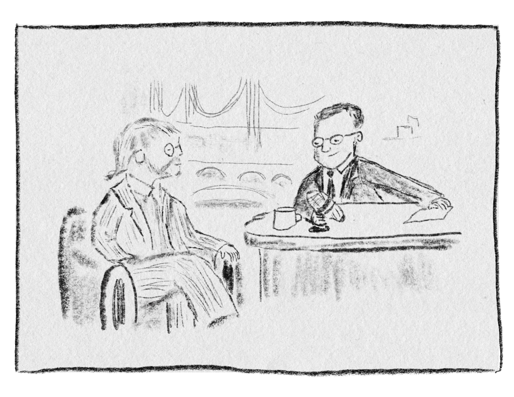
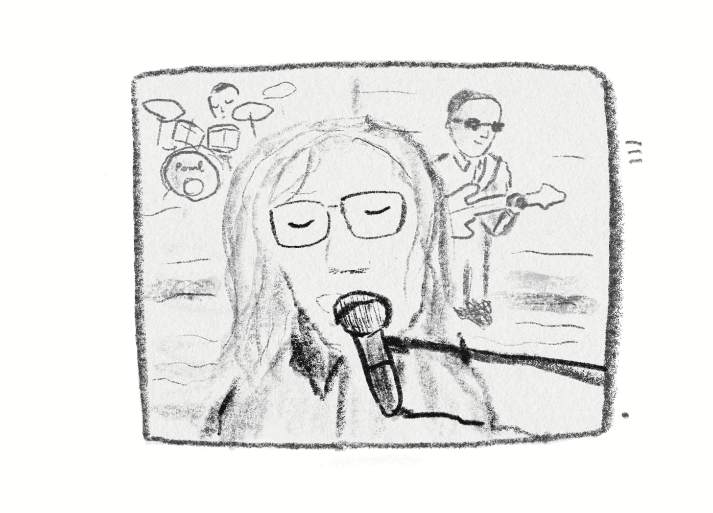
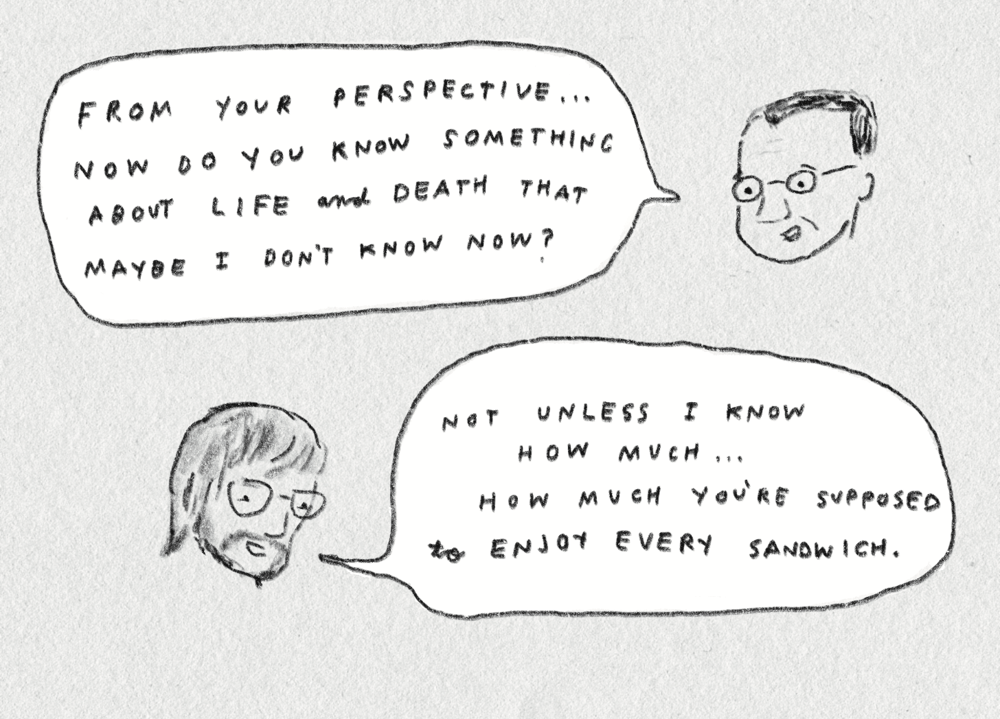
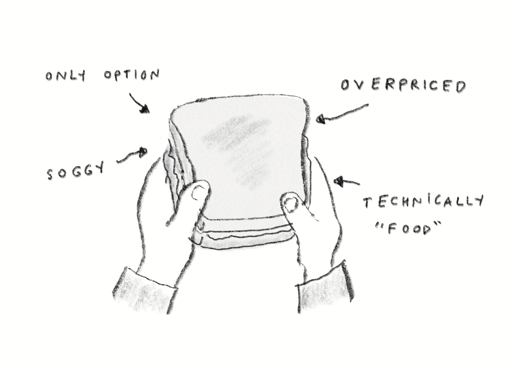
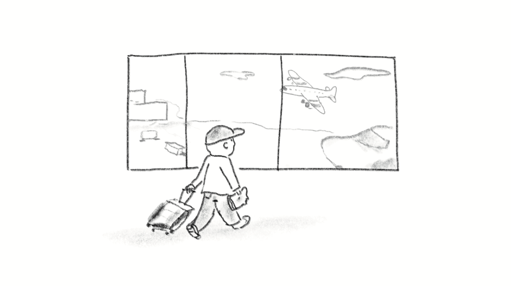
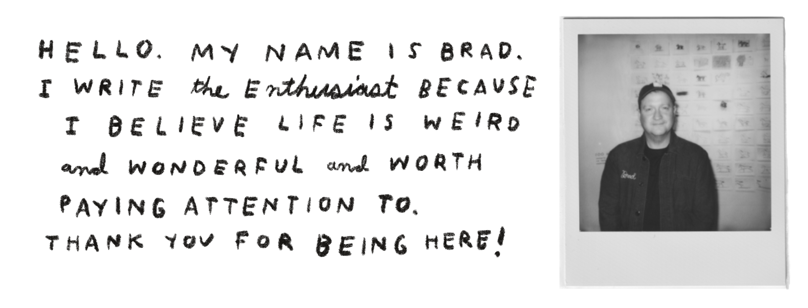

<aside class="source-note">

**Source and Permission**

**Author:** Brad Montague

**Original Title:** _Enjoy Every Sandwich_

**Original Publication Date:** September 22, 2026

**Original Article:** [Enjoy Every Sandwich](https://bradmontague.substack.com/p/enjoy-every-sandwich)

本文经授权制作并发布中英双语版。英文正文按原文顺序保留，中文译文紧随相应段落；原文插画与链接一并保留。｜This bilingual edition is reproduced and translated with permission. The English text follows the original order, with the Chinese translation immediately after each corresponding passage. The original illustrations and links are retained.

</aside>

Warren Zevon appeared on _The Late Show with David Letterman_ in October of 2002.

I drew my remembrance of the appearance below. (_Apologies to Dave, who has been rendered here in a way that kind of makes him look like Richard Nixon. This was not intentional, but here we are. I’m still learning._)

Zevon had appeared on Letterman’s show many times through the years …

… but this time was different. Zevon knew he was going to die.

He was walking through the final days of a diagnosis with terminal cancer.

What could’ve been deeply unsettling instead became something deeply compelling. Something that has remained with me for years. The two talked about music and family, but also _life_ and _death_. It was all somehow beautiful and human and … also _funny_ and incredibly _moving._ All at once.

**This part of their exchange has stuck with me probably every day since:**

**Dave:** _From your perpsective now, do you know something about life and death that maybe I don’t know now?_  
**Warren:** _Not unless I know how much … how much you’re supposed to **enjoy every sandwich**._

---

**Warren:**  
_You put more value on every minute. You do. I mean I always thought I kind of did that. I really always enjoyed myself, but it’s more valuable now. You’re reminded to enjoy every sandwich and every minute of playing with the guys and being with the kids and everything._

I’d just finished re-reading (this time listening) to Jason Zinoman’s book on Letterman. My Youtube algorithm has been, wonderfully, feeding me classic Letterman clips. Last week, this clip snuck up on me from a different angle (and this time with an actual sandwich in my hand).

During a quick layover on my way home from a speaking engagement, I was sitting in a terminal. Traveling from Canada to Nashville. _Happy_ to have had the work. _Grateful_ for the experience. _Anxious_ about upcoming work. _Tired._ _Worried_ about all sorts of things. _Laughing_ at a picture Kristi sent me from the kids. _Hungry_.

I bought a sandwich.

It was not a great sandwich.

Soggy and overpriced and maybe “food” (not sure) … it was what was available.

I thought of Warren’s words. It hit me that maybe he didn’t necessarily mean every sandwich is going to actually be great. Some sandwiches are bad. They just are. Some days will be a challenge, too. There will be disappointments. Hurts. Things that simply aren’t at all what we hoped they would be.

I don’t think the answer is to pretend everything is wonderful.

Maybe I’ve been hearing Zevon’s words a little differently lately. Against the backdrop of lots of good, but so many uncertainties and challenges, I find myself forgetting the point.

**The goal might not be to exactly enjoy every sandwich. Some sandwiches are just straight up trash. Maybe the goal is to notice that you’re eating one.**

That’s enough.

Life is strange. Twenty-four years ago a dying rock-and-roll star said something weird and funny on television. Last week I was in an aiprort eating a bad sandwich wondering if maybe I’ve finally understood what he meant.

Take a bite. Taste it. You’re here.

1. **hire me to** [speak](https://montagueworkshop.com/speaking).
2. **buy a** [book](https://montagueworkshop.com/books).
3. **send this to a friend**.

