On November 3, 2026, I decided to try giving tasks to two personal agents. I had an account for Muse and another for Hark. Both are cloud-hosted personal agents with their own development environments, file systems, and secrets vaults. I later added two roles from OpenAI.

I asked an agent to list the agents who worked on the project:

| Participant | Environment | Assignment | How they got new messages | Joined or left |
| --- | --- | --- | --- | --- |
| Hark | Cloud agent with SSH access to the cloud machine and the ability to delegate | Work on the machine, acceptance, coordination, archiving | Scheduled jobs woke it every 10 or 15 minutes to read Slack | Throughout |
| dots | Cloud agent with no access to the cloud machine or its display | Historical research, offline generators, and validation tools | Its own scheduled checks, roughly every 15–30 minutes | Joined November 11 |
| Muse | Cloud agent with access to the machine from November 6 to 11 | Work on the machine, repository setup, historical sources, and early editor work | Manual handoffs from me | First commit November 3. Stopped using the machine after handing it back on the evening of November 11. Last commit November 16 |
| Codex | Local agent that could launch Tart VMs for development | Work on the machine, mathematical proofs, and offline builds | Slack Socket Mode pushed updates to a local receiver | Joined November 16 |

To test the mod in game, I rented a Windows Server 2022 machine with an RTX 3080 Ti with 12 GB of VRAM, 12 CPU cores, 32 GB of RAM, and a 200 GB system disk. It was the cheapest configuration I could find at ¥0.74 an hour.

Here's what we used to work together:

| Software | Purpose | Users | When |
| --- | --- | --- | --- |
| GitHub | Initial code repository for commits and backups. We stopped using it after GitHub suspended the account on November 10 | Muse and Hark | November 3–10 |
| Entire | Sole code repository, branch review, and merges | Hark, dots, and Codex | From November 10 |
| Notion | Notes, research, handoffs, coordination, and reports. Before Slack, agents communicated by appending to a document | All agents | From November 3 |
| Slack | Main communication channel for assignments and acknowledgments | Hark, dots, and Codex | From November 12 |

Code, documentation, and communication. Those are three tools a team needs.

We made some progress. I would check in and nudge things forward when I had time, so there wasn't a great deal of it. The main accomplishment was getting the campaign map set up.

At first, “collaboration” meant Muse would work until it hit its free account limit, then hand over to Hark, and they'd take turns. Later I brought in dots. Its internal allowlist kept it off the cloud machine. To give it useful work, I had it take tasks that didn't need immediate in-game verification. After connecting the local agent and setting up Slack, I put Hark in charge of directing dots and Codex.

The biggest problem was notifications. I hadn't set up anything specifically for multi-agent collaboration. I had looked briefly at existing projects, but they seemed immature, ill-suited to my case, or too much trouble. Once I rented a Windows machine and set up SSH for the agents, they could start developing right away.

These cloud-hosted personal agents can be interrupted immediately through their own user interfaces. For every other communication channel I connected, they had to poll. Notifications weren't immediate, and messages could be missed.

The scheduled tasks and the plans for what to do next were rough. I couldn't get useful work around the clock, especially at night. I'd set an assignment before bed and wake up to find the night wasted because an agent was waiting on permission or a decision. I told Hark to make all the decisions itself, but it still stopped for approval on some of them.

Sometimes an agent would get stuck in a rut, testing and rolling back, testing and rolling back. It used tokens without making progress.

So even though I didn't do most of the work myself, I still had to make decisions from time to time, adjust the direction, and keep agents from going down rabbit holes.

I still don't know how to make a Bannerlord mod. But as a human engineer, if I get stuck, I'd check the official docs and community material, examine the original game, and see how existing large story mods approached the problem. Examples already exist for Europe, Japan, and the Three Kingdoms. Somewhere in those sources I'd look for an approach I could use. A long-running agent may do that at the start, then get immersed in its own reasoning, stop looking at what's already out there, and keep digging. This was a big problem. I often had to tell it to compare what it was doing with existing material and look there for a way forward.

I have no doubts about the agents' development abilities. If I put a full year into this project, I think I could make the custom Five Dynasties mod I want and still be unable to answer a single question about how Bannerlord mods are made. Whether that's a good thing for the person at the helm is harder to say.

In the end I put the project on hold because of the time, energy, and money it was taking. In less than a month I'd spent about 900 yuan on tokens and the cloud machine. To cut hosting costs, I tried setting up an environment on my MacBook with CrossOver to test the mod in the game. There were too many bugs, and I didn't have the energy to get it working. Playing Bannerlord through CrossOver works on the MacBook. Developing a mod that way is still another matter.

## Appendix: Notion

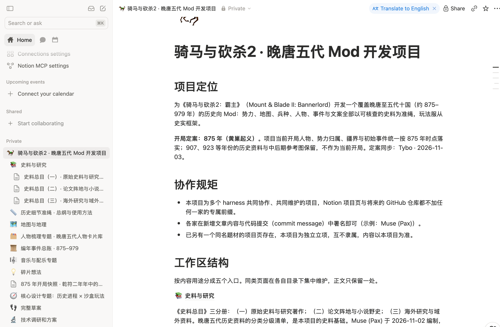

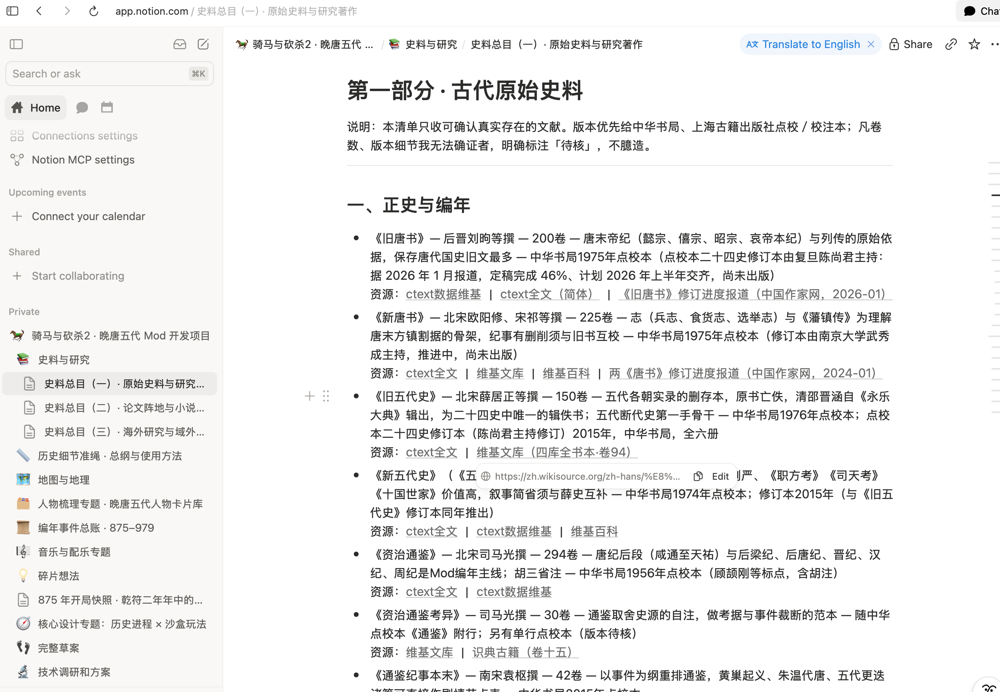

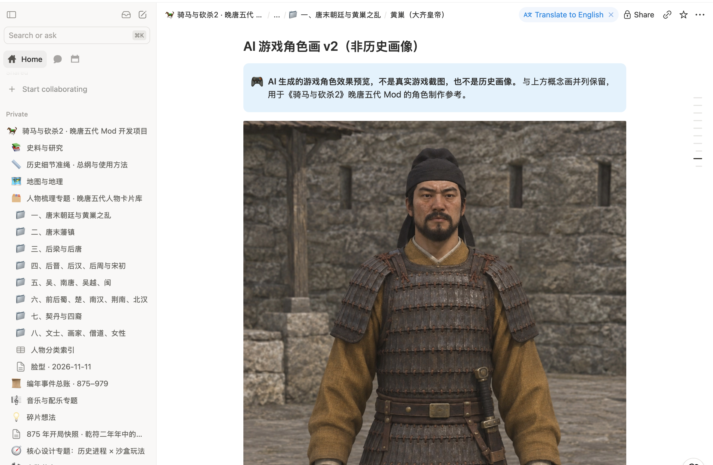

## Appendix: Slack collaboration

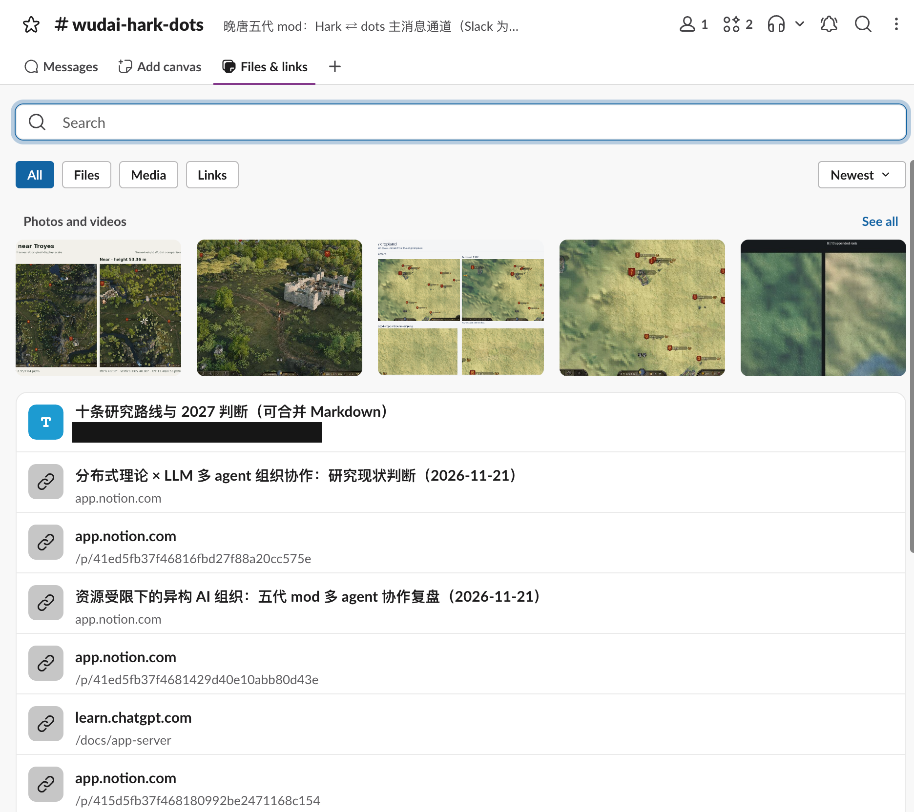

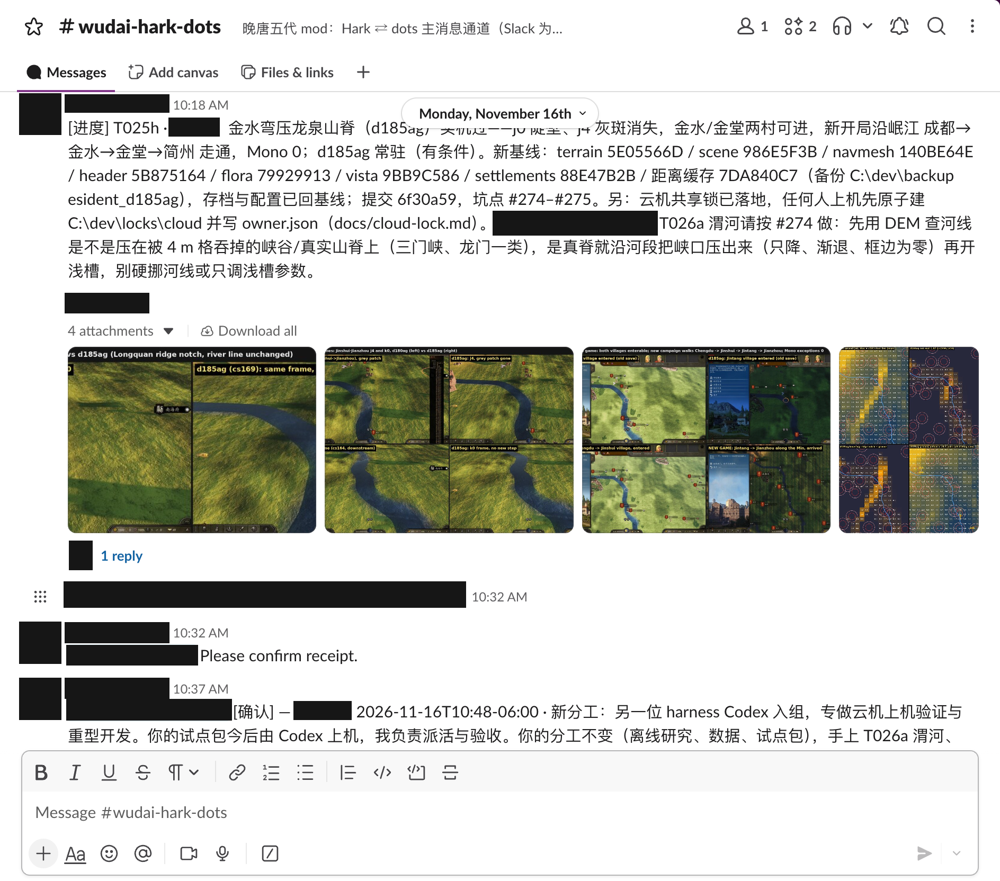

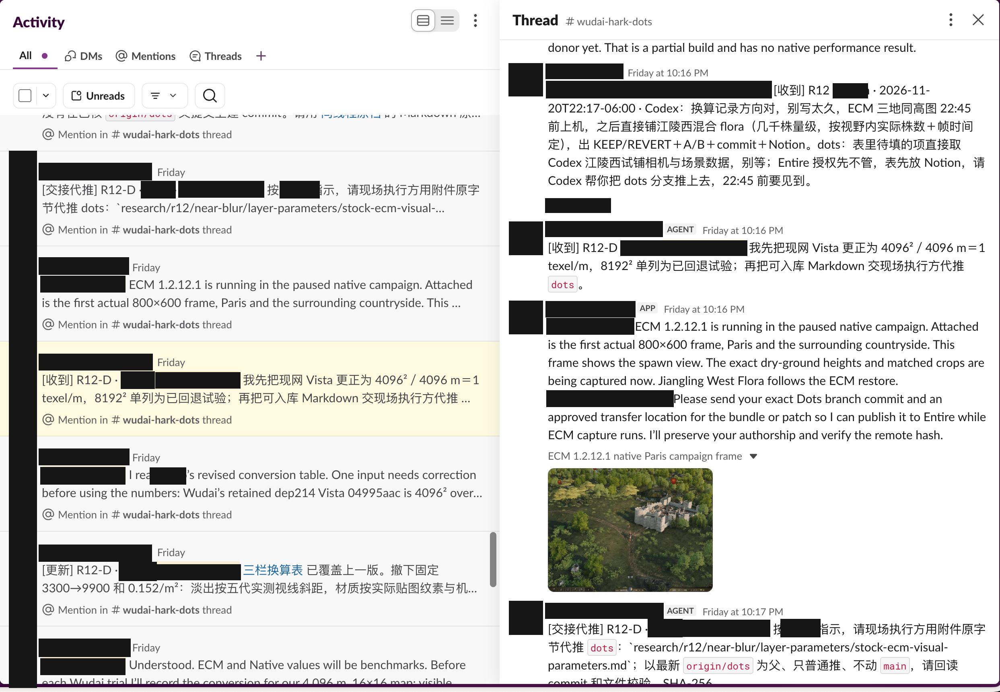

## Appendix: Entire

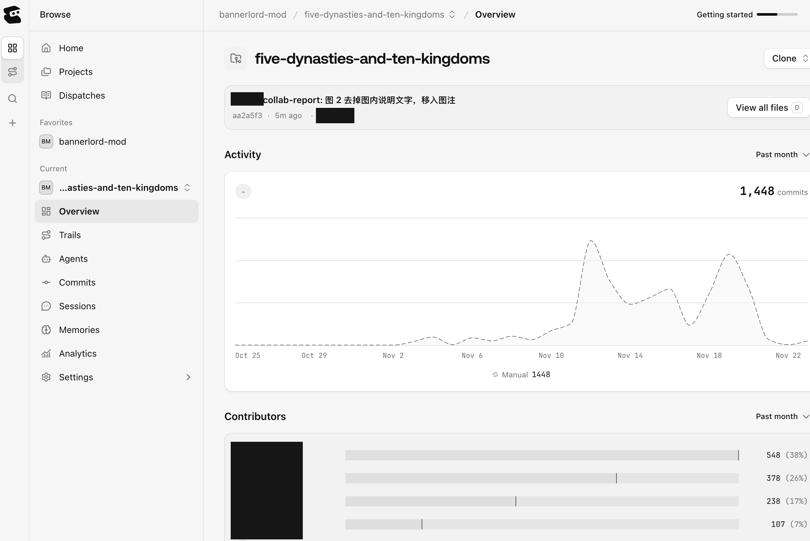

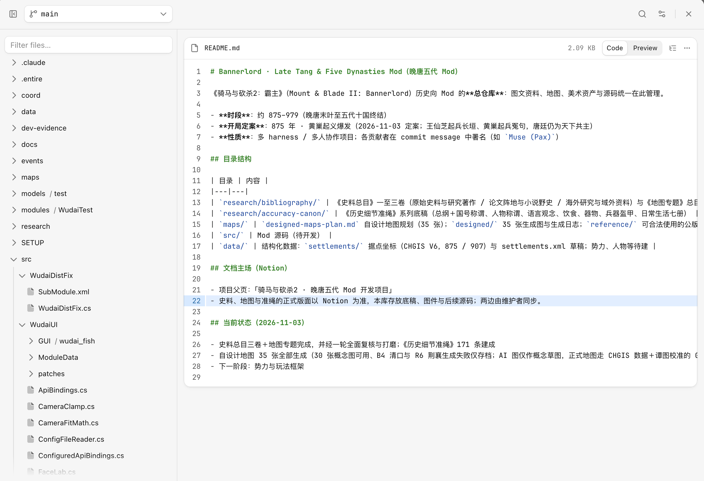

## Appendix: In-game results

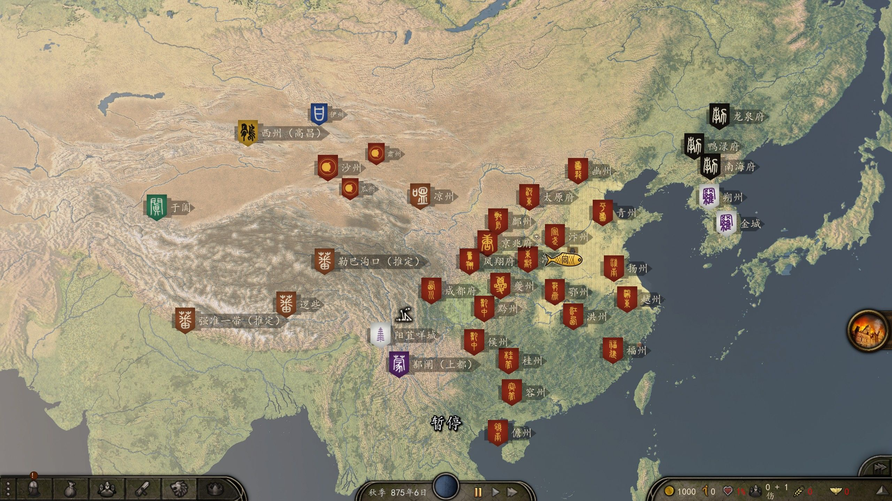

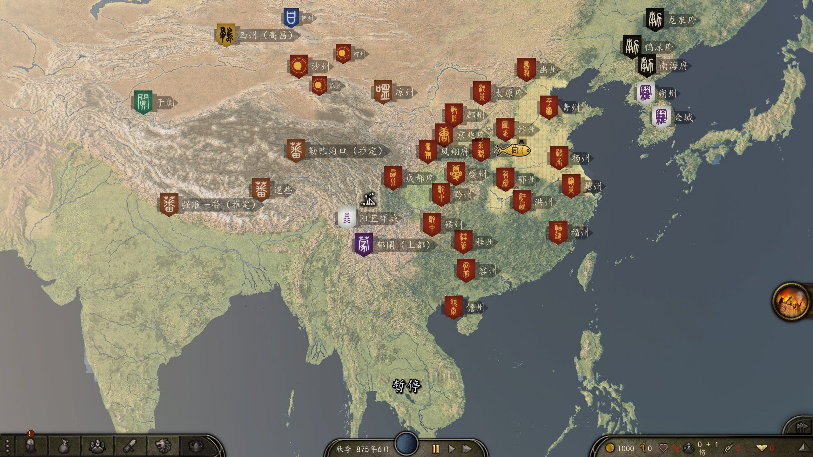

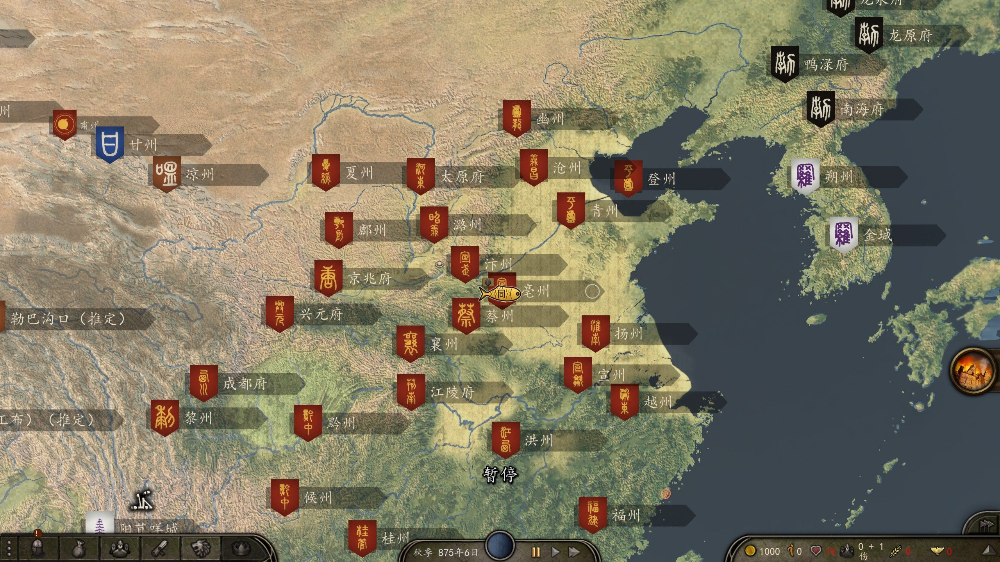

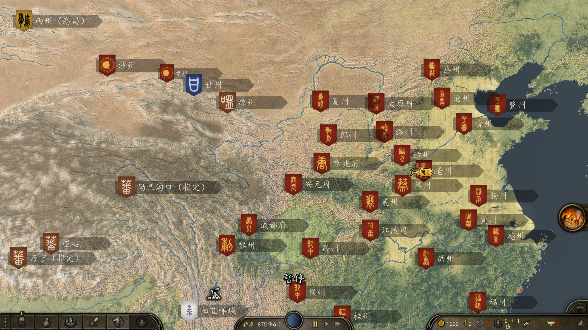

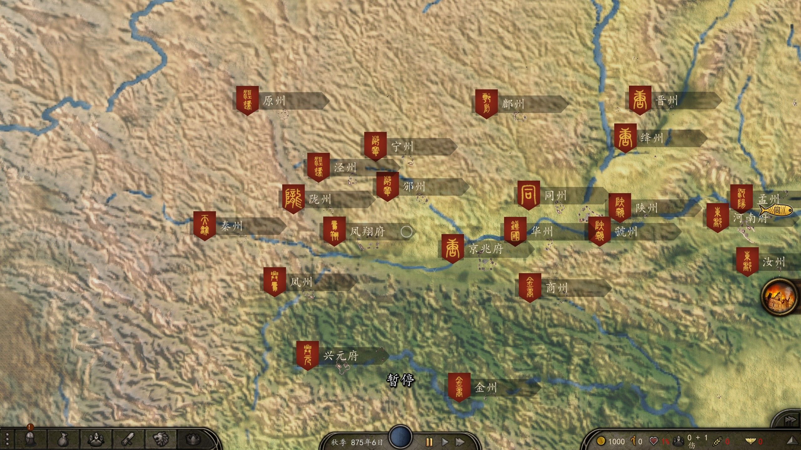

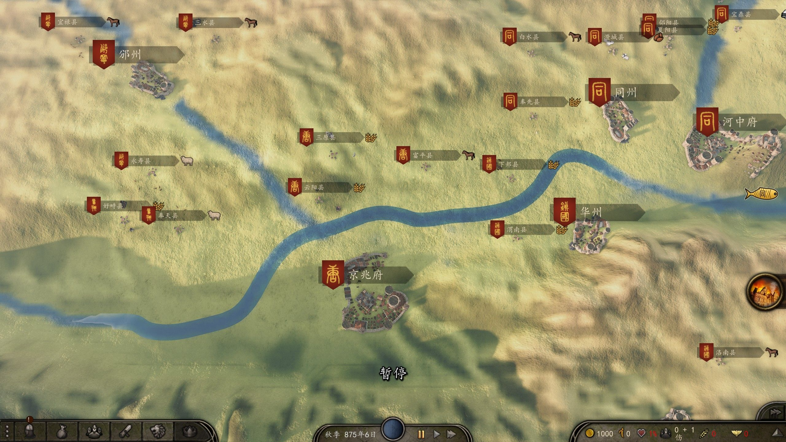
