2026年11月03号我准备利用手上两个personal agent做一些任务的实验，一个搞到的muse账号，一个hark账号。这两个是云端托管的personal agent，有自己的开发环境、文件系统以及secrets vault，后续又引入了openai家的两个角色。

让agent整理了一下参与这次开发的agent“人员”如下：

|参与者|环境|任务分配|如何得知新消息|加入/退出|
| --------| -------------------------------------------------------------------| --------------------------------------| ---------------------------------------| ------------------------------------------------------------|
|Hark|云端，经 SSH 驱动云机，可派子代理|上机、验收、协调、归档|定时任务（每 10/15 分钟）醒来读 Slack|全程；|
|dots|云端，没有云机，看不到画面|无法上机、考据、离线生成器、门禁工具|自身定时巡检（约 15–30 分钟）|11-11 加入|
|Muse|云端；11-06 至 11-11 上过云机|上机、建仓、史料、早期编辑器操作|用户手动交接|11-03 首次提交，11-11 晚交回后不再上机，最后一次提交 11-16|
|Codex|用户本地，配置了本地的Tart，Codex可以随意拉起Tart的VM用于专门开发|上机、数学证明、离线构建|Slack Socket Mode 推送到本地接收器|11-16 加入|

游戏mod的验证环境我给它们开了一台显存 12 GB（RTX 3080 Ti），CPU 12 核，内存 32 GB，系统盘 200 GB的Windows Server 2022，这已经是能找到的最便宜的配置了，按量¥0.74/小时。

使用的协作软件如下：

|软件|用途|使用方|时间段|
| --------| ---------------------------------------------------------------------------------------| -------------------| --------------|
|GitHub|最初的代码仓库，提交与备份；账号 11-10 被官方封禁，已弃用|Muse、Hark|11-03—11-10|
|Entire|唯一代码仓库，分支审合|Hark、dots、Codex|11-10 起|
|Notion|经验总结、调研、交接、协作台、报告，在引入Slack之前通过文档追加的方式充当消息沟通渠道|全部 agent|11-03 起|
|Slack|主沟通渠道，派活与回执|Hark、dots、Codex|11-12 起|

代码、文档、沟通软件，一个团队必要的三套软件工具。

整个开发搞下来，总得来说，有进展，因为这个mod开发任务是我有空的时候上去看两眼，催一催。所以并没有太多的进度，核心主要是搭建了大地图。

所谓的协作，一开始由于免费账号额度不够，是Muse跑一阵，然后限额了，交接给Hark，然后再轮替。后续引入了dots，dots由于其内部系统安全白名单，无法上机，这才为了利用dots，而产生了分工，然dots去做不着急上机验证的任务，然后后续接入了本地的agent工具，配置好了slack通信，才让Hark做指挥，指挥dots和Codex干活。

整个过程最大的问题，其实是“通知问题”，由于我没有去搞什么专门的多agent协作的系统和项目，之前简单调研过这类多agent协作的，一是不太成熟，二是和我的场景不契合，三是太费劲。我购买了windows主机之后个几个agent配置好ssh登录直接就是上手开发了。

这些云端托管的personal agent只有用户的入口有即时打断，其他的所有的通信软件的接入都是要靠轮询机制。无法即时通知，甚至有可能漏掉消息。

在任务执行上，目前设置的定时任务和任务的走向细化做的很粗糙，无法做到24h尤其是在夜间得到有效的产出，经常是睡前设置了任务，然后第二条早上醒来看进度，被各种情况导致当天晚上的时间浪费，譬如卡在权限申请和决策响应上，尽管我提前设置了任何决策由Hark自行决断，也没有用，偶尔的部分决策它仍然会要求批准。

还有的就是agent陷入了泥坑一直打转，或者称之为牛角尖出不来了，不停的测试回滚，测试回滚。导致空耗token，而无任何进展。

于是，尽管大部分工作和进度不是由我亲自做的，但是仍需要我是不是地做决策，调整方向，防止钻牛角尖。

并且，在一些卡点方案上，从人类工程师的角度，虽然我时至今日仍然不知道骑砍2mod该怎么做，但是我的方案必然是会查官方文档、社区资料、官方原始游戏的解析分析、已有的大型剧情类mod(譬如已有欧洲、日本、三国时期)的方案或者解析分析，无非要从这几种里面进行调研然后确定方案。但是长时间运行的agent可能在开始的时候会这么做，但是后面就陷进去了，完全沉浸在自己的逻辑中，一叶障目不见泰山，完全不参考和调研已有的资料，拼命钻牛角尖，这是个很大的问题。往往需要我提示纠正，让它去资料中做对比，找解法。

在agent的开发能力上，我丝毫不怀疑，如果我持续在这个项目上全身心投入一年，是可以做出我理想中的定制化的五代历史mod的，并且那时候我仍然可以对骑砍2游戏mod的制作细节一问三不知。但是对于一个“舵手”来说，一问三不知，是不是好事儿呢，很难说。

最终限于时间和精力以及金钱的投入，我目前暂时暂停了投入。不到一个月的时间，从Token的消费加上云主机的消费，总计约900元，将近1000元。为了节省主机的成本，我曾尝试在本地Macbook用CrossOver来搭建本地实机验证环境，但是最终由于bug太多，无精力调通而放弃，虽然Macbook利用CrossOver来玩骑砍2是没有问题的，但是用来开发还是问题多多。

## Notion内容附录：

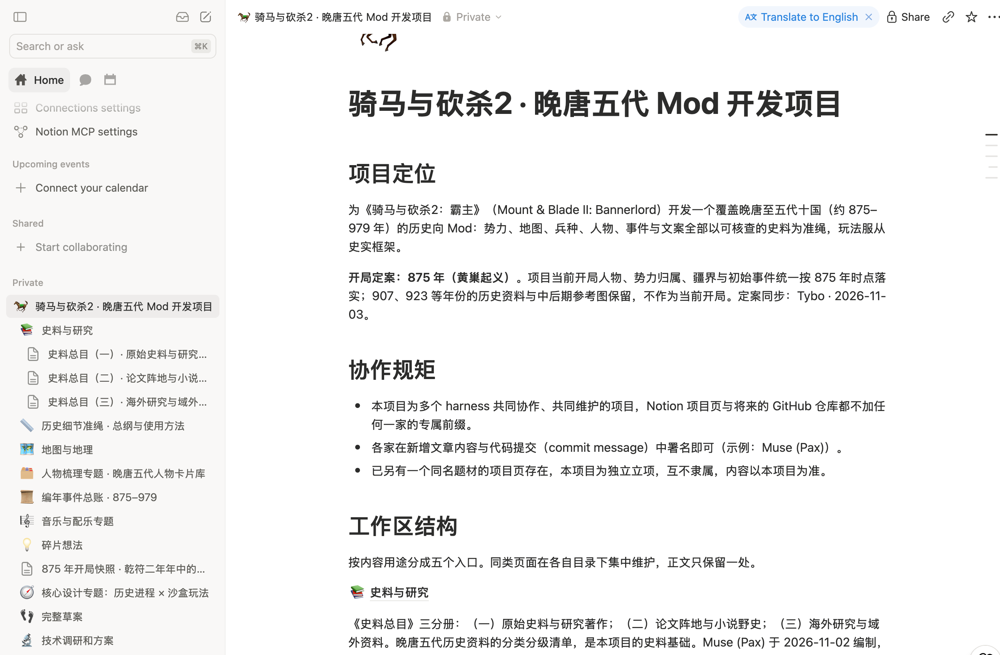

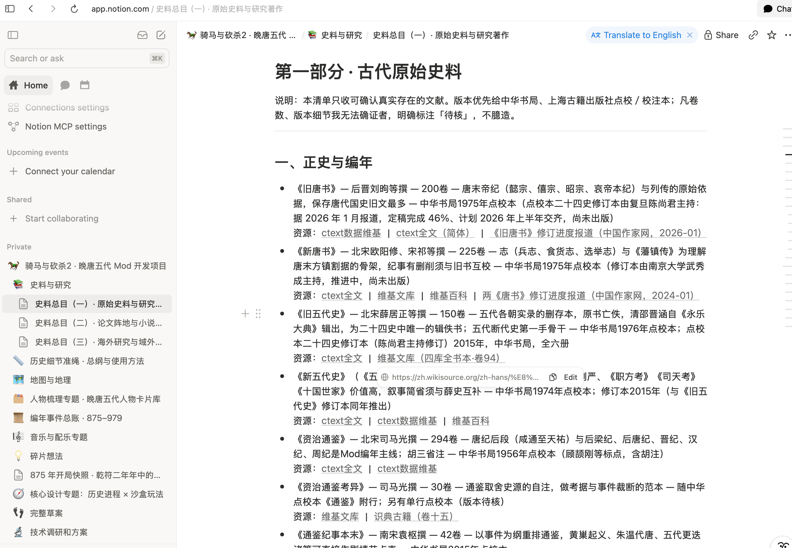

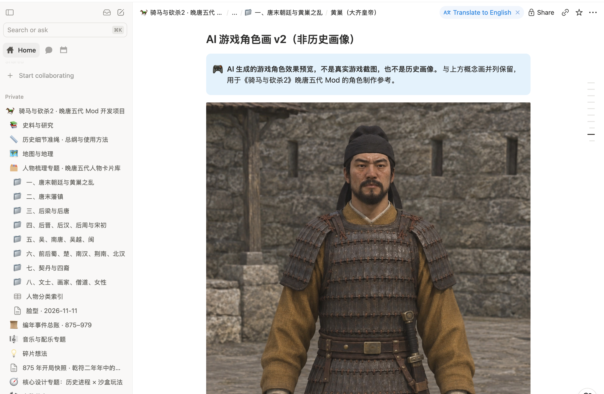

## slack协作附录：

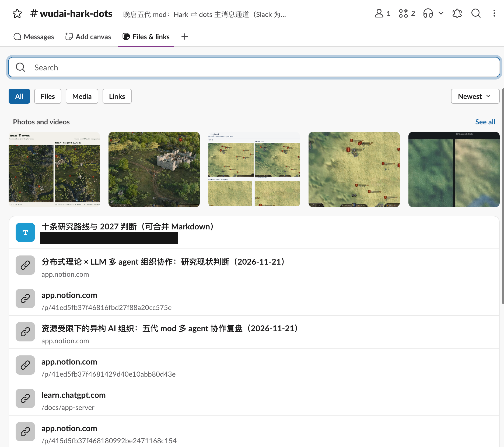

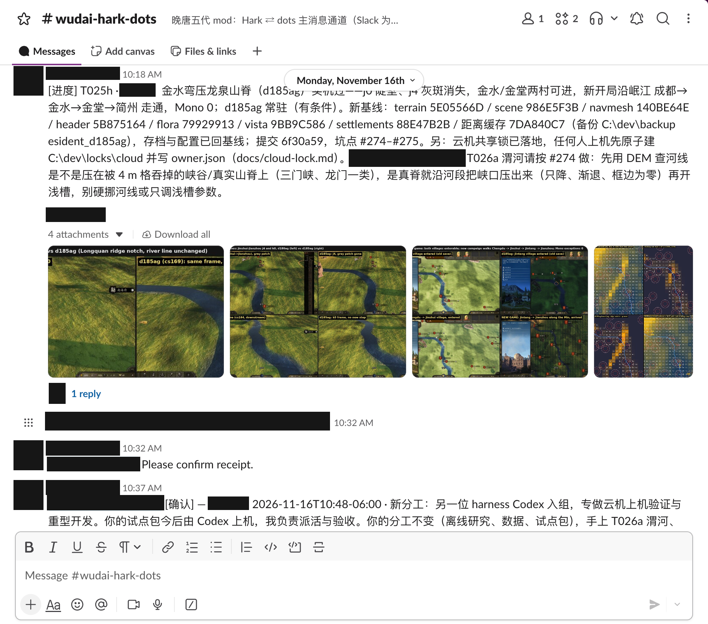

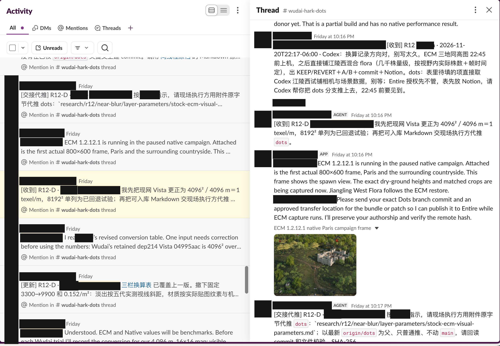

## Entire内容附录：

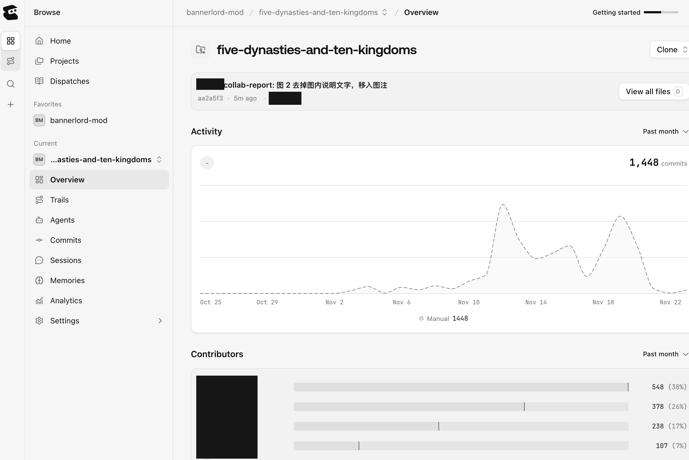

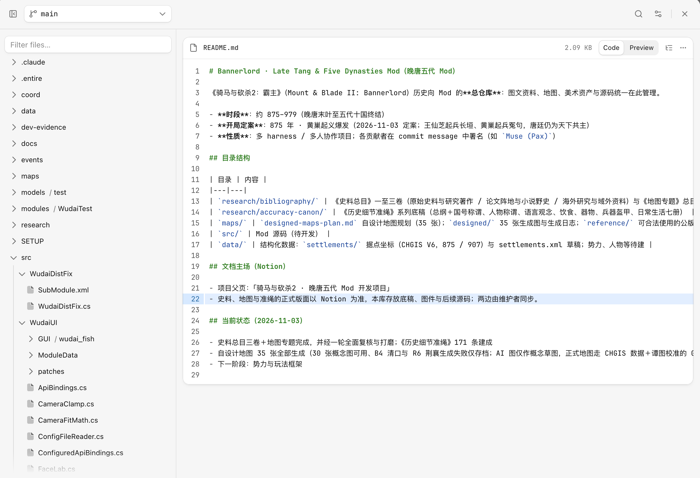

## 游戏实机效果附录：

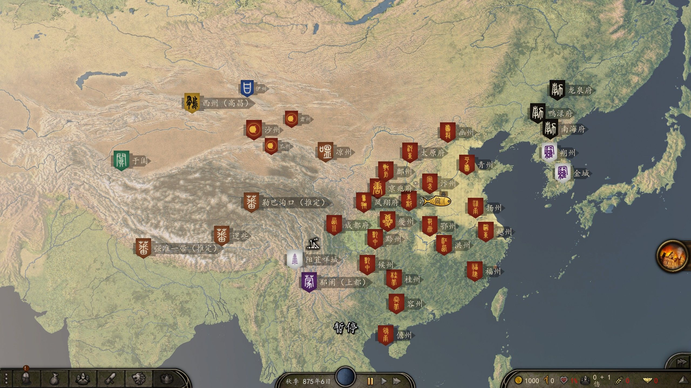

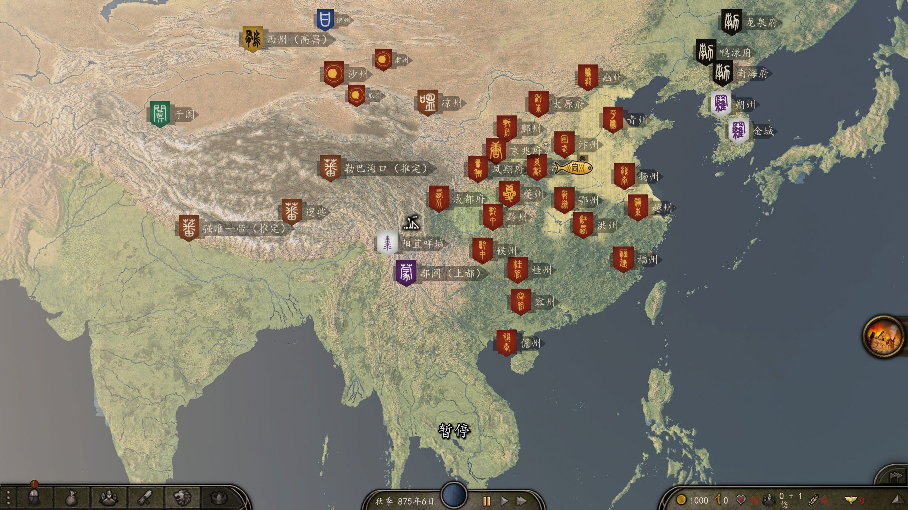

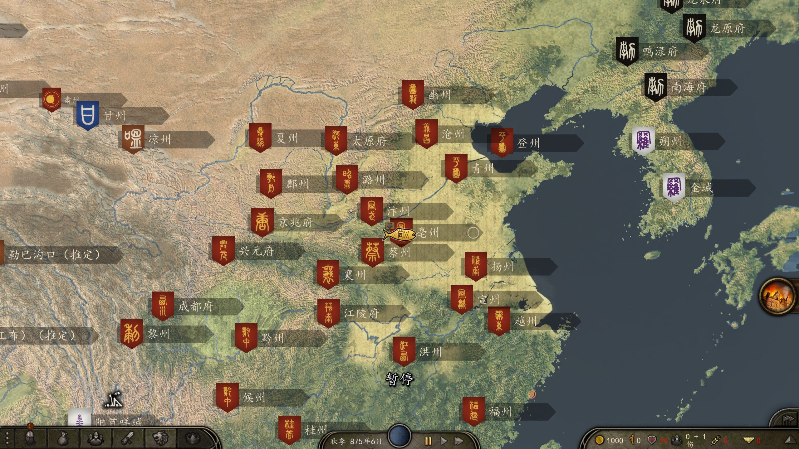

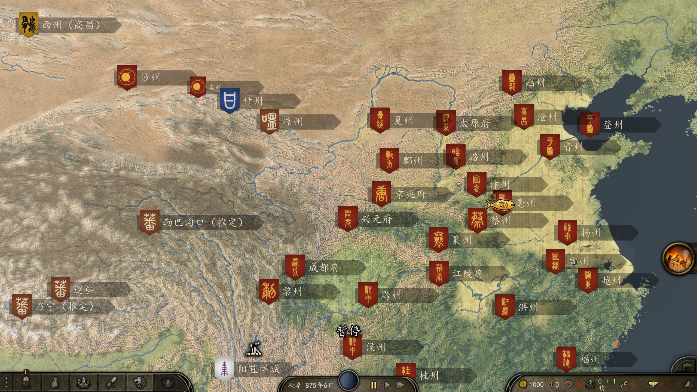

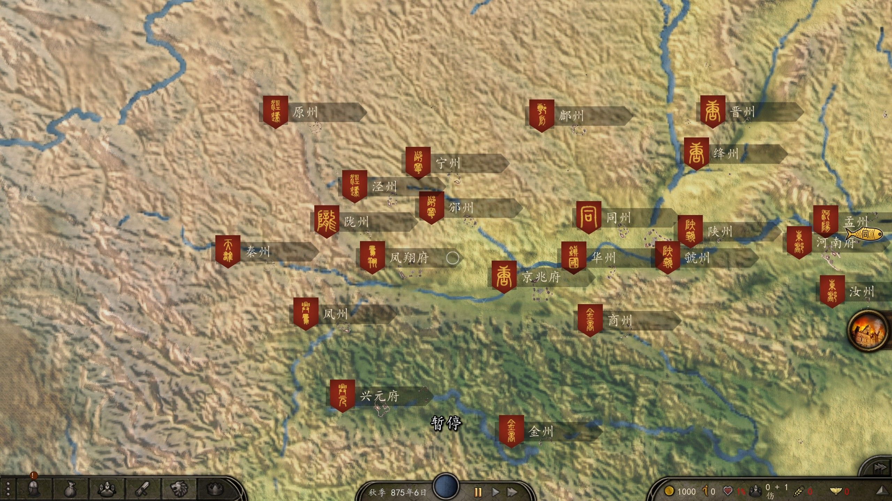

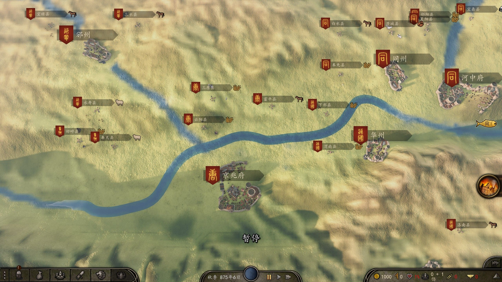

‍
