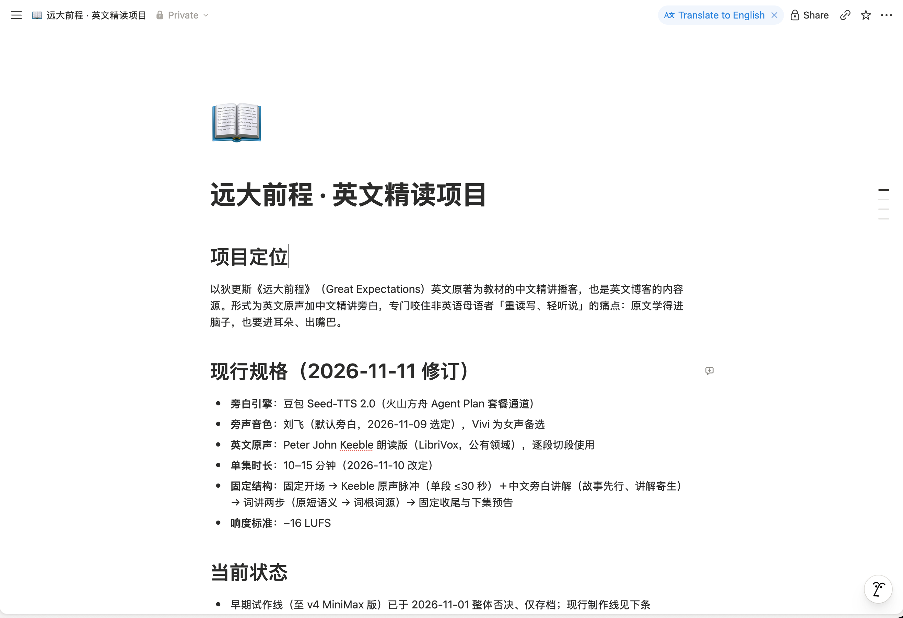
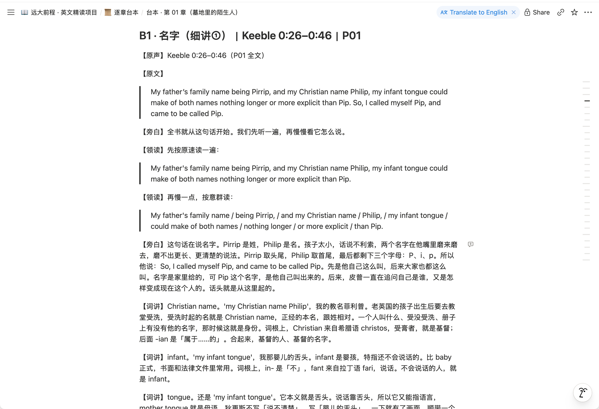

<audio controls preload="metadata" src="/audio/great-expectations-podcast-example.mp3" aria-label="Great Expectations podcast sample"></audio>

If the audio won't play, reload the page until the triangular play button turns dark and becomes clickable.

Muse led and produced the whole project. The basic process was to find references, choose source material and models, write a script, and produce the episode.

First I downloaded two shows I'd listened to for a long time on Ximalaya, *Stories Sound Better in a British Accent* (《故事还是英音的好》) and TeacherGwen's *Daily Reading* (《每日早读》). I liked the voice and style of the first, and the way the host guides listeners through the reading in the second. I wanted to combine them and get something better than either on its own.

After analyzing the shows, Muse settled on a production style. Next came the source material. Dickens's book is in the public domain, so we could use the text freely. I looked at public-domain readings on **LibriVox** and chose clips by **Mil Nicholson, Peter John Keeble, and Mark F. Smith** for the opening. **Mark F. Smith's reading is the narration of the original text in the episode.**

Muse and I went back and forth on the script a few times, then decided it was ready for a first listen.

Next I looked into audio models from MiniMax, ElevenLabs, Fish Audio, Cartesia, and Hume AI. While doing that I signed into my Google account inside Muse's virtual machine and let Muse use it to register with the various services. I suspect that was a major reason Google suspended the account. Muse's official Google integration was probably fine. Signing in inside its virtual machine may have been the bigger problem.

After looking at a bunch of options, I ended up buying a Volcengine token plan advertised as temporarily discounted from 200 yuan to 50. It included voice models, so I had Muse generate samples of every voice. I listened to them in turn and settled on Doubao's Liu Fei.

I modeled the opening on *Stories Sound Better in a British Accent*. I originally wanted to cut clips from screen adaptations of *Great Expectations*, but the agent refused over copyright concerns, so **I cut the opening from public-domain LibriVox recordings**.

I also had Muse try making an opening in the style of a radio play with several Doubao voices. The performances were too wooden to use, and I didn't have the patience to fine-tune them. I went back to the opening cut from readings.

On the whole, the podcast was much easier to make. I expect it will get better with a little polish from time to time.

