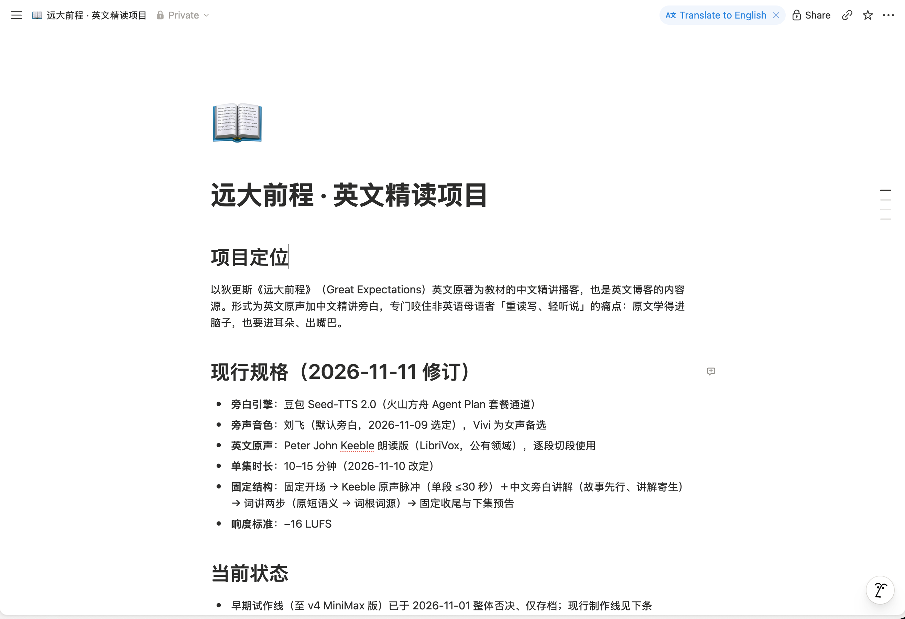
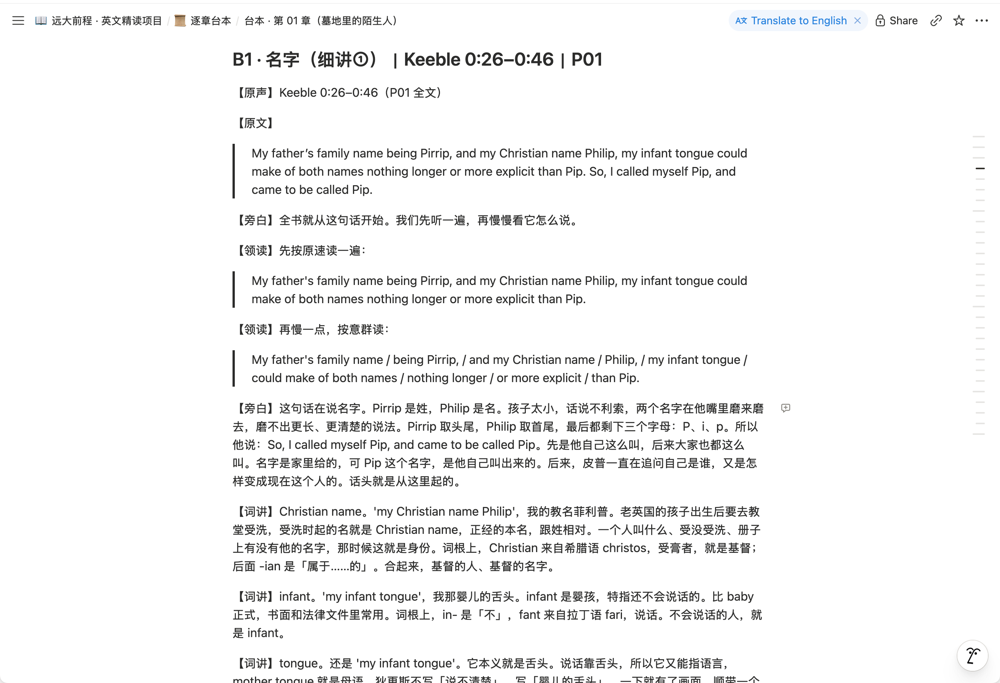

<audio controls preload="none" src="/audio/great-expectations-podcast-example.mp3" aria-label="《远大前程》播客案例示范"></audio>

这个项目全称由Muse主导和制作，基本的制作流程是，选参照物，选素材，选模型，做脚本(剧本)，制作。

首先我是下载了之前在喜马拉雅上长时间听过的《故事还是英音的好》、TeacherGwen《每日早读》两党节目，前者是我喜欢它的声音和风格，后者是喜欢作者带读的形式。我的初步理想效果是二者的结合，且做到1+1>2。

Muse在剖析了之后，基本确定了制作风格。然后就是调研素材，首先是狄更斯这本书是公办书，文本上没有限制；我还调研了一份**LibriVox** 平台的公有领域朗读，选取了**Mil Nicholson、Peter John Keeble和Mark F. Smith**的朗读来作为片头剪辑素材，并采用**Mark F. Smith的朗读作为博客中放原文的播音。**

脚本和Muse来回打磨的几次，觉得可以做初版试听了，看看整体的效果。

接着就是调研音频模型，MiniMax、ElevenLabs、Fish Audio、Cartesia、Hume AI。也就是在调研音频模型的时候，我把我的google账号在Muse虚拟机内部登录了，并授权Muse使用该账号注册各个模型，估计这个是google封号的一大原因，官方Muse的接入google应该没事儿，在Muse虚拟机内部可能问题比较大。

调研了一堆，最终无意间被火山引擎的营销忽悠过去买了个说是原价200，限时50块的token plan，这个token plan里面有语音模型，于是让Muse制作了模型的所有音色，挨个试听，最中挑中了豆包的刘飞的音色。

在片头的制作中，我基本上仿照的是《故事还是英音的好》的风格，本来是想用《远大前程》的影视作品来剪片头的，但是agent拒绝了，因为版权问题。于是只好用**LibriVox的公有领域朗读作品来剪片头。**

期间我还试过让Muse使用豆包的各类音色来导演制作一个话剧风格的片头，但是音色表演上太生硬了，完全没法儿用，我也没有耐心去调了，还是用会朗读版剪辑的片头。

播客总体来说，制作起来简单很多，后续时不时打磨一下，估计效果会进一步好很多。

